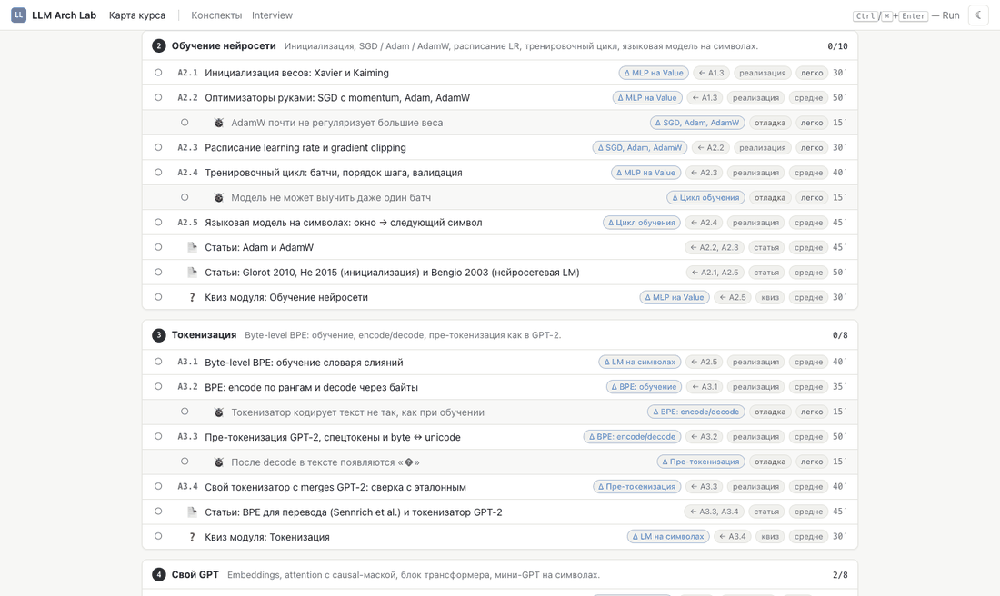
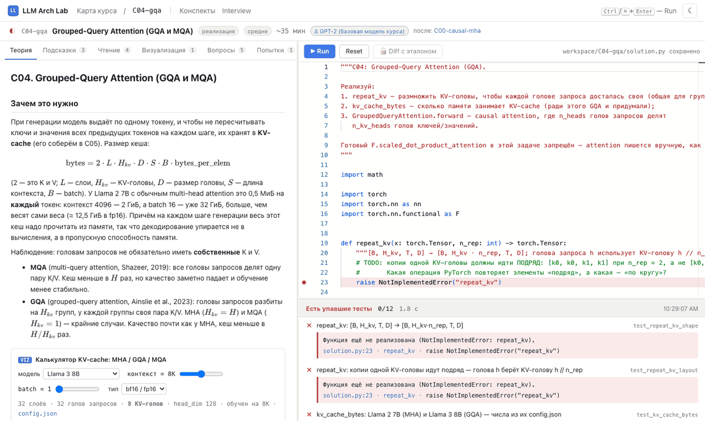
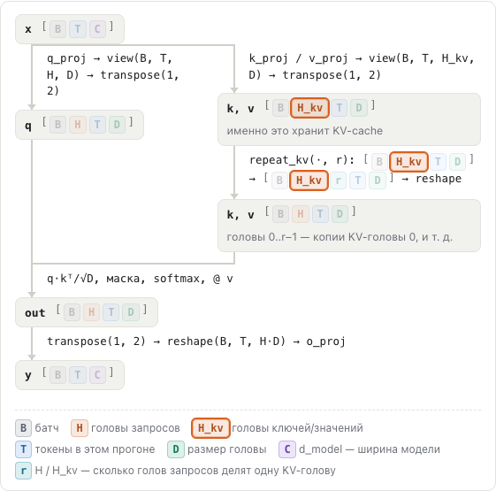
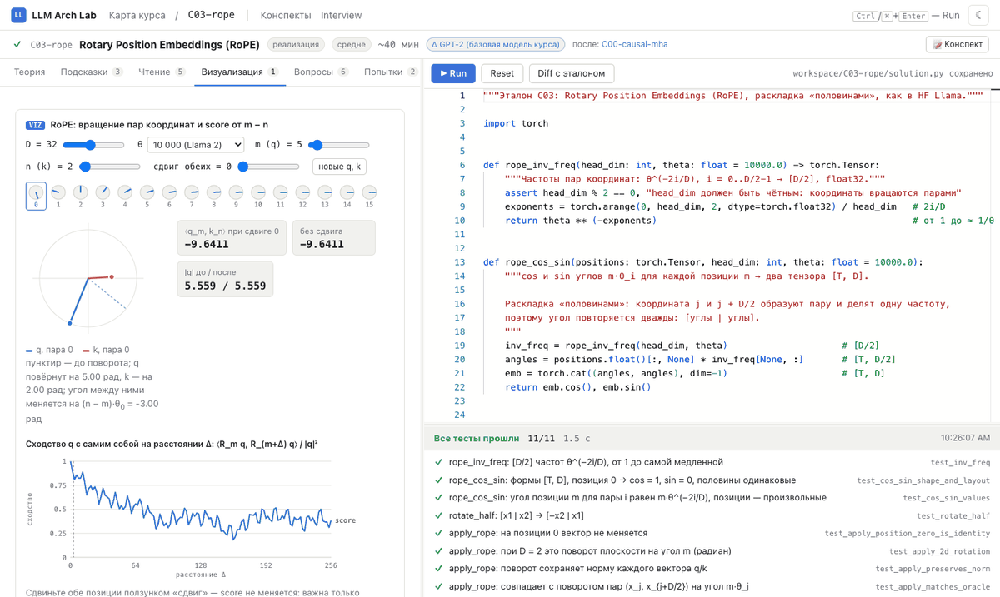
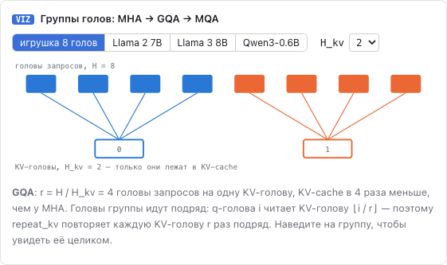
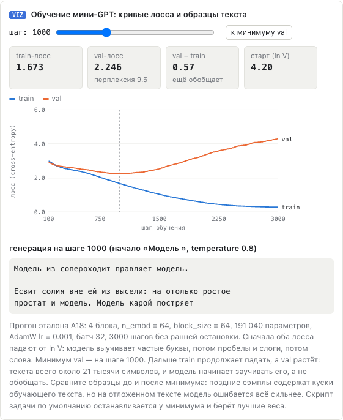
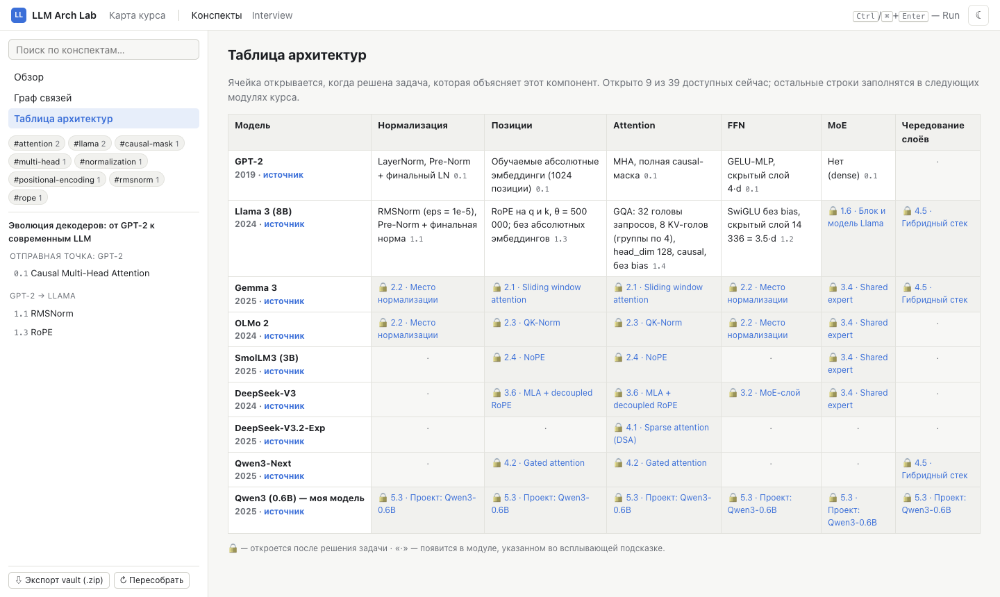
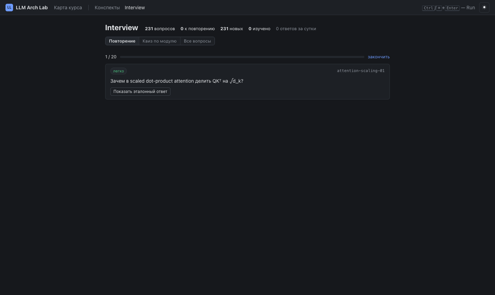

# LLM Arch Lab

Локальный интерактивный курс: шаг за шагом реализуешь эволюцию LLM-архитектур — от своего маленького GPT
(необязательный блок A: autograd, обучение, BPE, трансформер с нуля) через GPT-2 к Llama,
Gemma 3 / OLMo 2, MoE и MLA из DeepSeek и гибридам с линейным вниманием — и в финале загружаешь в свой код
настоящие веса Qwen3-0.6B. Каждая задача — маленький кусок механизма (15–60 минут) с автотестами, теорией,
подсказками, визуализациями и автоконспектом.



Всё работает офлайн на CPU: код запускается локально через pytest, интерфейс — в браузере на `127.0.0.1`,
прогресс — в SQLite рядом с курсом, конспекты — Markdown-файлы, совместимые с Obsidian.

## Быстрый старт

Нужны Python 3.11+ и git. Удобнее всего с [uv](https://docs.astral.sh/uv/) — он сам поставит подходящий
Python и CPU-сборку PyTorch:

```bash
git clone https://github.com/georgemoretti/llm-arch-lab && cd llm-arch-lab
uv sync
uv run llmlab doctor         # проверка окружения: что не так и как починить
uv run llmlab serve          # откроет http://127.0.0.1:8765
```

<details>
<summary>Без uv (pip)</summary>

```bash
python -m venv .venv
source .venv/bin/activate            # Windows: .venv\Scripts\activate
# Linux / Windows: CPU-сборка torch (~200 МБ вместо ~2 ГБ с CUDA); на macOS шаг не нужен
pip install torch --index-url https://download.pytorch.org/whl/cpu
pip install -e .
llmlab doctor && llmlab serve
```
</details>

Node.js не нужен: собранный интерфейс лежит в репозитории. На Windows интерфейс и вывод CLI на русском —
лучше запускать в Windows Terminal.

## Что внутри

**Блок A — фундамент (необязательный).** Основы, которые блок C считает известными: autograd
на скалярах, backprop по тензорам, оптимизаторы, BPE-токенизатор и свой маленький GPT. Если всё это знакомо,
начинай сразу с блока C. Итоговый квиз блока сводит построенное в таблицу «что ты сделал → где это в блоке C».

| модуль | что реализуешь | задач |
|---|---|---|
| A1. Autograd | `Value` с графом и backward, проверка градиентов, MLP на скалярах, backprop Linear / ReLU / softmax-CE, backward LayerNorm | 9 |
| A2. Обучение нейросети | инициализация Xavier/Kaiming, SGD/Adam/AdamW, warmup + cosine, clipping, цикл обучения, языковая модель на символах | 10 |
| A3. Токенизация | byte-level BPE: обучение, encode по рангам, decode через байты, пре-токенизация GPT-2, спецтокены, загрузка `merges.txt` GPT-2 (= `tokenizers`) | 8 |
| A4. Свой GPT | эмбеддинги и позиции, weight tying, attention с causal-маской, блок pre-LN / post-LN, мини-GPT на корпусе курса: обучение (~30 с на CPU) и генерация | 8 |

**Блок B — энкодеры (необязательный, в работе).** Вторая ветка трансформеров: исходный энкодер-декодер, дальше
BERT, DistilBERT, T5, ModernBERT и эмбеддинги для поиска. Для блока C не нужен.

| модуль | что реализуешь | задач |
|---|---|---|
| B1. Transformer: энкодер и декодер | padding-маска и multi-head, синусоидальные позиции, энкодер Post-LN, cross-attention, seq2seq с label smoothing и greedy decode, проект «число цифрами → число словами» (~25 с на CPU) | 11 |

**Блок C — эволюция декодеров.**

| модуль | что реализуешь | задач |
|---|---|---|
| 0. Отправная точка | causal multi-head attention GPT-2 | 1 |
| 1. GPT-2 → Llama | RMSNorm, SwiGLU, RoPE, GQA, KV-cache, блок Llama | 14 |
| 2. Gemma 3 / OLMo 2 / SmolLM3 | sliding window, размещение норм, QK-Norm, NoPE, кольцевой KV-cache | 11 |
| 3. MoE и DeepSeek | роутер, MoE-слой, балансировка, shared expert, MLA, MTP | 14 |
| 4. Эффективное внимание | sparse attention, gated attention, линейное внимание, Gated DeltaNet, Mamba-2 | 11 |
| 5. Финальный проект | модель из YAML, config.json и веса HF, сэмплирование, Qwen3-0.6B, генерация | 3 |

Кроме задач «реализуй» есть задачи на **отладку** (код с одним правдоподобным багом), **чтение статей** с
вопросами и **квизы** по модулям. Каждая задача начинается с вопроса «что поменялось относительно
предыдущей архитектуры».

## Как это выглядит

**Задача.** Слева — теория с формулами и схемами форм тензоров, подсказки, ссылки, визуализации, вопросы;
справа — редактор. Ctrl/⌘+Enter прогоняет тесты. Сообщения об ошибках объясняют, что сломано («выход
зависит от токена t+1 → утечка через маску»), и ведут к строке. Код лежит в `workspace/<id>/solution.py` —
можно писать и в своём IDE, интерфейс подхватит изменения.



**Схемы форм тензоров** нарисованы, а не набраны псевдографикой: каждая ось окрашена по смыслу (батч, длина,
d_model, головы, размер головы…), наведение на ось подсвечивает её во всей схеме, под схемой — легенда.



**Визуализации** — интерактивные и есть у каждой задачи, кроме квизов: вращение пар координат в RoPE, группы
голов GQA, LayerNorm vs RMSNorm, место нормы и рост остаточного потока, QK-Norm, NoPE vs RoPE, маски sliding
window, калькулятор KV-cache для реальных моделей, маршрутизация MoE, Multi-Token Prediction, состояние
линейного внимания / DeltaNet, маска Mamba-2, гибридные стеки, сэмплирование, бюджет параметров Qwen3-0.6B. В блоке A — граф autograd по шагам, траектории SGD / Adam, BPE
по шагам на любом тексте, кривые обучения мини-GPT.







**Конспекты.** После первого зелёного прогона интерфейс просит 1–3 строки «Главное, что я понял» и собирает
`notes/<блок>/<id>.md`: выжимку, формулу, твой код, diff с эталоном, ошибки по пути и вопросы для
повторения. Во вкладке «Конспекты» — поиск, теги, граф связей и **таблица архитектур**: ячейка «модель ×
компонент» открывается, когда решена задача, которая этот компонент объясняет.



**Interview** — все вопросы курса (и твои вопросы с собеседований, см. `docs/QUESTIONS_IMPORT.md`) с
интервальным повторением по SM-2, квизами по модулям и фильтрами.



## Без браузера

```bash
llmlab list                           # задачи и статус
llmlab init-workspace C00-causal-mha  # заготовка → workspace/C00-causal-mha/solution.py
llmlab test C00-causal-mha            # прогнать тесты на своём решении
llmlab notes build                    # пересобрать конспекты (твои выводы сохраняются)
llmlab notes export                   # zip с конспектами
llmlab questions import               # импорт своей базы вопросов из data/interview_raw/
llmlab doctor                         # проверка окружения
```

## Финальный проект: своя модель на настоящих весах

Все детали курса собираются в одну модель из YAML (`llmlab/core/model.py`, конфиги — `llmlab/configs/`,
схема и как добавить компонент — `docs/MODEL.md`). Задачи **C24** (config.json и имена весов), **C25a**
(сэмплирование: temperature, top-k, top-p) и **C25** (загрузка safetensors, генерация, сверка логитов с
`transformers`) превращают её в настоящую Qwen3-0.6B.

```bash
uv sync --extra weights                       # huggingface_hub, tokenizers, transformers (для сверки)
llmlab model                                  # готовые конфиги и число параметров
llmlab model qwen3-0.6b                       # расписание слоёв
llmlab generate qwen3-0.6b "The capital of France is"
llmlab generate qwen3-0.6b "Name three planets of the solar system" --chat -n 60
llmlab generate smollm2-135m "Once upon a time" -t 0.8 --top-p 0.9

llmlab test C25-qwen3-project                 # тесты на случайных весах — без скачивания
llmlab test C25-qwen3-project --weights       # + логиты и генерация против transformers на реальных весах
llmlab generate qwen3-0.6b "Hello" --impl workspace   # генерировать своими решениями C25 и C25a
```

Первый запуск с реальными весами скачивает ~1.5 ГБ в `~/.cache/huggingface`. Без `--weights` (и без
`LLMLAB_WEIGHTS=1`) тесты `@pytest.mark.weights` пропускаются, так что курс работает и офлайн.

## Для авторов

- `docs/CONTRIBUTING.md` — как поставить окружение, добавить задачу и проверить её перед PR;
- `docs/TASK_FORMAT.md` — формат задачи, интерфейсы платформы и чек-лист качества;
- `docs/MODEL.md` — конфигурируемая модель: схема YAML, реестр компонентов;
- `llmlab validate --all` — эталоны проходят тесты, заготовки — нет, debug-баги ловятся;
- `pytest tests/` — тесты платформы;
- фронтенд: `cd web && npm ci && npm run dev` (Vite на :5173, API проксируется на `llmlab serve`),
  сборка — `npm run build` → `llmlab/static/` (бандл коммитится).

Тексты задач написаны для курса; на статьи и блоги — только ссылки. Числа реальных моделей — из официальных
`config.json` на Hugging Face или статей, источник указан рядом.

Лицензия — MIT (`LICENSE`), атрибуции — `NOTICE`.
